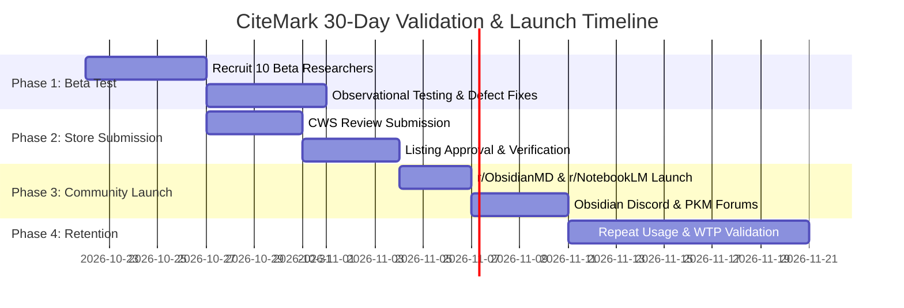

# 30-Day Validation & Ethical Distribution Plan (DISTRIBUTION_PLAN.md)

**Product:** CiteMark for Gemini Notebook (NotebookLM Exporter)  
**Target Beachhead:** PKM Researchers, Academic Writers, and Knowledge Workers using Obsidian/Notion  
**Core Thesis:** Researchers who use Gemini Notebook want complete multi-turn conversation exports with unbroken footnote attributions in clean Markdown, without cloud privacy risks.  
**Guiding Philosophy:** Honest distribution rooted in user utility. No fake reviews, no paid astroturfing, no spamming communities, no hype.

---

## 1. 30-Day Phased Execution Timeline

---

## 2. Target Communities & Ethical Engagement Rules

### Community 1: Reddit `r/ObsidianMD` (~170,000 members)
- **User Pain:** Exporting syntheses from AI notebooks into vault notes requires manually fixing broken footnote numbers `[1]` and re-formatting headers.
- **Subreddit Rule Compliance:** Rule 3 (Self-Promotion): Must be genuinely useful to the Obsidian community, free or clearly open-source, with no affiliate links or disguised advertisements.
- **Post Angle:** Problem-first, open-source utility announcement.
- **Draft Post Concept:**
  > **Title:** *Tired of NotebookLM stripping your citations? I built CiteMark—a 100% offline extension that exports Gemini Notebook chats to Obsidian with valid GFM footnotes.*  
  > **Body:** Explains the specific problem ("Google Docs export strips conversation turns and turns citations into unlinked text"). Demonstrates the before/after: raw chat vs clean Obsidian note with `[^1]` footnotes matching uploaded PDFs. Links to open-source repository and Chrome Web Store. Solicits feedback on frontmatter formats.

### Community 2: Reddit `r/NotebookLM` (~35,000 members)
- **User Pain:** Trapped exploratory conversations; Google's native UI only exports studio notes, not the back-and-forth chat history.
- **Subreddit Rule Compliance:** Helpful contribution; answering recurring user questions ("How do I export my full chat with sources?").
- **Post Angle:** Solving the most requested native feature gap.
- **Draft Post Concept:**
  > **Title:** *How to export full multi-turn chats from Gemini Notebook / NotebookLM (with sources & studio notes)*  
  > **Body:** Practical step-by-step tutorial answering the recurring question of preserving chat history. Mentions manual copy limitations vs 1-click CiteMark export. Fully transparent about local processing and privacy.

### Community 3: Obsidian Community Discord (#plugins / #showcase)
- **Audience:** Power users, researchers, note-taking enthusiasts who actively curate complex vaults.
- **Engagement Strategy:** Share sample Markdown export files with YAML frontmatter. Ask for feedback on note metadata properties.

---

## 3. First-User Observational Beta Protocol (10 Testers)

Before broad public promotion, run structured 1-on-1 observational sessions with **10 real researchers** (graduate students, analysts, or technical writers) who actively use Gemini Notebook with at least 5 uploaded documents:

### Test Protocol Script:
1. **Unprompted Setup (3 mins):** Ask tester to install the unpacked extension or CWS link without guidance. Observe if permissions cause hesitation.
2. **First Export Task (3 mins):** Ask tester: *"Export your most recent research notebook to your preferred note-taking tool."*
   - Measure: Time-to-first-value (seconds).
   - Observe: Do they understand the format selection? Do they discover the Selective Turn Filter?
3. **Fidelity Verification (5 mins):** Have the tester inspect the generated Markdown file in Obsidian:
   - Are all prompt/response turns present in order?
   - Do footnote citations `[^1]` accurately cite their uploaded papers?
   - Did any lazy-loaded turns get dropped?
4. **Post-Task Interview Questions:**
   - *"What did you use to export or save this information before today?"* (Verifying real alternatives: manual copy-paste, Google Docs).
   - *"What was the most frustrating or confusing moment during this export?"*
   - *"Would you keep this installed in your browser for your next research session? Why or why not?"*
5. **Willingness-to-Pay Probe (Only asked if they exported successfully 3+ times):**
   - *"The core single-file Markdown export is permanently free. Would you pay a one-time $14 fee for batch ZIP archiving of all Studio notes and custom frontmatter templates, or is the free version sufficient for your work?"*

---

## 4. Primary Success Metrics & Funnel

| Funnel Step | Metric | Target Benchmark | Measurement Method |
|---|---|---|---|
| **Discoverability** | CWS Impressions & Repo Views | 1,000+ views in Month 1 | CWS Developer Console / GitHub Traffic |
| **Activation** | First Successful Export Rate | > 80% of installs execute an export within 24h | User follow-ups / issue frequency |
| **Export Integrity** | Scan Completeness Rate | > 98% complete scans (zero missing turns) | Logged in SafeDiagnosticsTracker |
| **Retention** | Repeat Exporting Users | > 40% of beta cohort exports 3+ notebooks | Direct user testing cohort check-ins |
| **Support Burden** | Critical Bug Reports | < 3 issues per 100 active users | GitHub issue tracker |
| **Monetization (Pro)** | Willingness-to-Pay Conversion | > 5% of repeat users expressing willingness to purchase Pro | Direct survey / landing waitlist |

---

## 5. Experiment Backlog (ICE Scored)

Ranked by **Impact** (1-10), **Confidence** (1-10), **Ease** (1-10), and calculated **ICE Score** (`I * C * E`):

| Rank | Experiment Description | Hypothesis | Impact | Confidence | Ease | ICE Score |
|---|---|---|:---:|:---:|:---:|:---:|
| **#1** | **Obsidian Callout Formatting Option** | Formatting assistant answers into Obsidian native callouts (`> [!note]`) will increase vault adoption among PKM power users. | 8 | 9 | 9 | **648** |
| **#2** | **One-Click "Copy Markdown" Activation Prompt** | Adding a 1-click clipboard notification simplifies quick note drafting for users who don't want a file download. | 7 | 9 | 9 | **567** |
| **#3** | **Interactive Before/After Demo on Repo README** | Showing an animated comparison between raw NotebookLM chats and clean Obsidian notes will double install conversion. | 8 | 8 | 8 | **512** |
| **#4** | **Subreddit Problem-First Tutorial Post** | Publishing a comprehensive guide on managing Gemini Notebook citations in Obsidian will drive high-intent early adopters. | 8 | 7 | 8 | **448** |
| **#5** | **Direct Zotero / BetterBibTeX Key Sync** | Allowing users to map source documents to local Zotero citekeys (`[@vaswani2017]`) will unlock academic researcher loyalty. | 9 | 6 | 5 | **270** |

---

## 6. Explicit Kill & Pivot Criteria

To prevent throwing good effort after bad, CiteMark commits to objective pivot gates:

- **Kill Criterion 1 (Lack of Need):** If fewer than 20% of beta testers perform a second export within 14 days, and state *"copy-paste is easy enough,"* the stand-alone exporter thesis is falsified. **Action:** Pivot from a dedicated extension to an open-source bookmarklet or Obsidian plugin importer.
- **Kill Criterion 2 (Google UI Breakage / Hostile Regressions):** If Google alters Gemini Notebook's DOM to obfuscate turn containers or block DOM scraping, and workarounds require intrusive techniques that violate user privacy or stability. **Action:** Sunset the DOM scraper and redirect to clipboard parsing.
- **Kill Criterion 3 (Zero Willingness-to-Pay for Pro):** If after 50 active weekly users, zero users indicate willingness to pay $14 for the Pro ZIP bundler or custom frontmatter. **Action:** Maintain CiteMark as a permanent 100% free open-source community tool and discontinue commercial Pro development.
