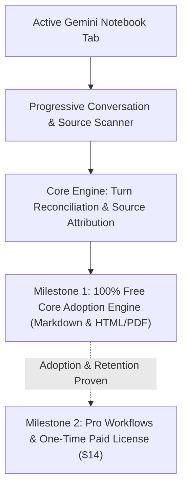

# Product Requirements Document (PRD): CiteMark for Gemini Notebook

**Document Version:** 1.5 (Audited & Feasibility-Bounded)  
**Target Platform:** Chromium Browsers (Chrome, Brave, Edge) via Manifest V3  
**Target Domains:** `notebook.google.com` and `notebooklm.google.com`  
**Privacy Status:** 100% Client-Side Local Execution — Zero Remote Network Calls for Core Functionality

---

## 1. Executive Summary & Problem Definition

### 1.1 The Core Problem
Gemini Notebook (formerly NotebookLM) is widely used by researchers and knowledge workers to query collections of documents. However, getting multi-turn research conversations *out* into local knowledge vaults (Obsidian, Notion, Word) remains broken:
1. **Interactive Research Chats are Trapped:** Google only exports single studio notes; multi-turn exploratory conversations cannot be exported natively in full.
2. **The "Footnote Graveyard":** Native export to Google Docs unlinks citation chips, leaving dead numbers `[1]` with no reference to the underlying source document.
3. **Existing Tool Gaps:** Competitor tools are either bloated multi-tools (ExportKit), require switching to external cloud converters (BibCit/MassiveMark), or focus purely on ingestion (Kortex).
4. **Feasibility Reality:** Gemini Notebook's DOM exposes source document titles and excerpts, but **does not expose formal academic metadata (authors, DOIs, publication years)**. Claiming automated APA/BibTeX bibliographies from the DOM alone is technically unfeasible without external APIs.

### 1.2 The Solution
**CiteMark for Gemini Notebook** is an ultra-fast, 100% in-browser extension that captures complete multi-turn research conversations and exports them to **Obsidian-ready GitHub-Flavored Markdown (.md)** and **Print-Ready HTML/PDF**, with **all inline citations mapped to verified source document titles and referenced excerpts**.

---

## 2. Target Personas & Core User Stories

### 2.1 Primary Persona: PKM Researcher & Knowledge Worker
- **Profile:** Graduate student, policy analyst, or technical writer who queries 10–50 papers in Gemini Notebook and keeps their knowledge base in Obsidian or Notion.
- **Goal:** Move structured syntheses into their vault with one click, preserving headings, tables, turn order, and clear source document attribution.

### 2.2 Core User Stories
- **US-1 (Full Conversation Capture):** As a researcher, I want to export the entire multi-turn conversation from the active notebook tab with one click, so that no prompt or response turn is lost.
- **US-2 (Lazy-Load Turn Reconciliation):** As a power user with 30+ turns, I want the extension to verify that all virtualized turns have been loaded before exporting, so that I never get a truncated file.
- **US-3 (Source Document Attribution):** As an analyst, I want inline citation markers (`[1]`) to link to attributed footnotes containing the uploaded source document title (`[^1]: [Document_Name.pdf] — "excerpt"`), so that I know exactly which paper supported each claim.
- **US-4 (Obsidian Markdown Fidelity):** As an Obsidian user, I want clean GFM markdown with valid footnotes, tables, and callouts, so that my notes render immediately without syntax cleanup.
- **US-5 (Standalone Print/PDF View):** As an executive writer, I want a clean, styled HTML view ready for print-to-PDF, so that I can share a briefing memo with colleagues who do not use Markdown.

---

## 3. Scope & Phased Architecture (Milestone 1 vs Milestone 2)

### 3.1 Milestone 1: Core Adoption Engine (100% Free, Zero Billing Code)
The sole goal of Milestone 1 is to discover whether researchers need the tool badly enough to adopt it, rely on it, and export repeatedly without errors:
1. **Full-Chat Chronological Export:** Captures all user prompts and assistant responses in authentic chronological sequence.
2. **Progressive Lazy-Load Reconciliation:** Scans conversation container, measures scroll progress, and verifies completeness before export.
3. **Source Document Attribution:** Resolves inline citation chips (`1`, `2`) to the active Source Shelf document names (`[^1]: source_filename.pdf`) and loaded excerpt quotes.
4. **Dual-Format Output:** Download clean `.md` (GFM compliant) or standalone `.html` view for native Print-to-PDF.
5. **Zero Gating:** No license checks, no email wall, no billing code.

### 3.2 Milestone 2: Pro Workflows & Monetization (Post-Adoption Gate)
*Dependent on Milestone 1 passing adoption thresholds (>40 active test users, repeat exports, zero critical DOM failures):*
1. **Obsidian Frontmatter & Template Engine:** Custom YAML header with user-defined tags, aliases, date tokens, and notebook metadata.
2. **Selective Turn Filter:** Interactive preview list allowing users to deselect irrelevant prompt/response turns before generating the final export.
3. **Publication-Grade Print Theme:** Enhanced academic styling (serif typography, customized margins, header/footer page numbers) for executive PDF export.
4. **Batch Studio Bundler:** One-click download of all Studio notes bundled alongside the active conversation in a single ZIP.
5. **One-Time Paid License:** Lightweight client-side license verification via ExtensionPay or LemonSqueezy.

---

## 4. Explicit Non-Goals & Boundary Constraints

1. **NO Payment Gateways or Checkout Code in Milestone 1:** We will not write billing, licensing, or payment code until real user adoption is demonstrated.
2. **NO Fabricated Bibliographic Data (Capability C):** We will NOT promise automated APA/MLA/BibTeX references with authors and DOIs from the DOM alone. All citations are strictly attributed to source document filenames and verbatim excerpts.
3. **NO Cloud Storage Syncing:** No Google Drive API, Notion API, or cloud storage sync in v1. All files download directly to the local disk.
4. **NO User Accounts or Custom SaaS Backend:** No database, no user logins, no server infrastructure.
5. **NO Canvas DOM Injection:** The UI lives strictly in the browser action popup. Zero injected banners, modals, or sidebars inside Google's canvas.
6. **NO Study / Flashcard Tools:** No Anki deck generation or quiz scrapers.

---

## 5. Technical & Security Architecture

### 5.1 Manifest V3 Permissions
- **Permissions:**
  - `activeTab`: To inspect the active Gemini Notebook tab on user trigger.
  - `scripting`: To execute the resilient DOM scanner in the page context.
  - `storage`: To persist user preferences (format choice, Pro license key) locally.
  - `downloads`: To trigger file downloads to the user's local disk.
- **Host Permissions:**  
  Strictly restricted to:
  - `*://notebook.google.com/*`
  - `*://notebooklm.google.com/*`
- **Zero External Telemetry:** No Google Analytics, Mixpanel, or remote event logging.

### 5.2 Resilient DOM Extraction Strategy
- **Container Target:** Target semantic message regions (`role="region"`, `role="log"`, aria-labels) rather than volatile generated CSS class names (`.mat-mdc-*`).
- **Source Registry Ingestion:** Inspect the Sources panel on the left shelf to build a local map of `SourceIndex -> DocumentTitle`.
- **Progressive Scroll Scanner:** If conversation scroll height exceeds visible viewport, execute progressive scroll steps with 150ms debounce until `scrollHeight` stabilizes, verifying turn IDs in memory.

---

## 6. Acceptance Criteria & Quality Gates

1. **Completeness Invariant:** 100% of user turns and assistant responses from a 25-turn virtualized test conversation are captured with zero missing or re-ordered bubbles.
2. **Attribution Integrity:** Every inline citation marker `[1]` in assistant turns is mapped to the exact corresponding document filename from the Sources shelf; zero unlinked bracket numbers.
3. **Format Validity:** Exported `.md` file parses with zero errors in Obsidian, rendering valid GFM tables, code blocks, and footnotes.
4. **Selective Turn Filtering (Milestone 2):** Users can deselect specific turns via interactive checkboxes; exported turns re-index sequentially `1..M` without numbering gaps; active citation counts live-update.
5. **YAML Frontmatter (Milestone 2):** Standard Obsidian/Logseq frontmatter block bounded by `---` includes title, date, URL, tags, aliases, and quantitative turn/source metadata.
6. **ZIP Archive Bundler (Milestone 2):** Pure client-side `fflate` zip bundler packs `Conversation.md`, `Conversation.html`, `Sources_Bibliography.md`, and `Studio_Notes/*.md` into an uncorrupted ZIP archive.
7. **Local Execution Proof:** Zero external network requests recorded in Chrome DevTools Network panel during export. 100% local operation verified.
